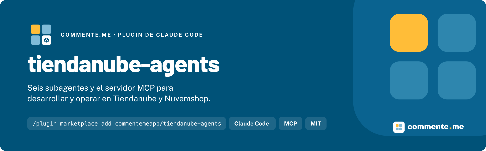

<p align="center">
  
</p>

# tiendanube-agents

**Seis subagentes de Claude Code y el servidor MCP para desarrollar y operar en Tiendanube y Nuvemshop.**


## Instalación

```bash
/plugin marketplace add commentemeapp/tiendanube-agents
/plugin install tiendanube-agents@tiendanube-agents
```

Reinicia Claude Code o corre `/reload-plugins`. Los agentes aparecen en el typeahead de `@` como `tiendanube-agents:tiendanube-reviewer`, y los servidores MCP como `tiendanube`, `tiendanube-admin` y `nuvemshop-admin`. Para consultar una tienda, conecta el Admin MCP de su marca con `/mcp` y autoriza la tienda.

## Uso rápido

Por mención:

```
@tiendanube-agents:tiendanube-reviewer revisa lo que acabo de cambiar en el receptor de webhooks
```

Por lenguaje natural, sin nombrarlos:

```
diseña la sincronización de stock por location entre el ERP y las dos tiendas
```

Por sesión completa:

```bash
claude --agent tiendanube-agents:tiendanube-integration-architect
```

El servidor MCP también responde directo en la conversación: "que scope necesita `POST /orders/{id}/fulfillment-orders`?", "arma el receptor de webhooks para `order/paid` con la verificación de firma".

## Que incluye

Para apps de partners, integraciones propias y la operación de tiendas: Admin API, OAuth, webhooks, catálogo, pedidos y fulfillment, NubeSDK, apps del Admin y temas.

| Agente                             | Que hace                                                                                                   | Skills que precarga                                                                                        | Herramientas MCP                                                                                               | Modelo    |
| ---------------------------------- | ---------------------------------------------------------------------------------------------------------- | ---------------------------------------------------------------------------------------------------------- | -------------------------------------------------------------------------------------------------------------- | --------- |
| `tiendanube-explorer`              | Mapea el proyecto: OAuth, llamadas a la Admin API, webhooks, NubeSDK y panel del Admin. Read-only.         | `tiendanube-admin-apps`, `tiendanube-nube-sdk`                                                             | `lookup-endpoint`, `lookup-webhook-event`                                                                      | haiku     |
| `tiendanube-reviewer`              | Revisa el diff antes del deploy: OAuth, firma de webhooks, uso de la Admin API, NubeSDK.                   | `tiendanube-oauth-apps`, `tiendanube-webhooks`, `tiendanube-rest-api`, `tiendanube-nube-sdk`               | `search-docs`, `read-doc`, `lookup-endpoint`, `lookup-scope`, `lookup-webhook-event`                           | `inherit` |
| `tiendanube-qa`                    | Corre lint, tipos, pruebas y build del proyecto y devuelve solo las fallas.                                | `tiendanube-rest-api`, `tiendanube-webhooks`                                                               | ninguna, a propósito                                                                                           | sonnet    |
| `tiendanube-integration-architect` | Diseña y audita integraciones con ERP, OMS, WMS y PIM y migraciones: dueño de cada dato, flujos y límites. | `tiendanube-erp-integration`, `tiendanube-orders-fulfillment`, `tiendanube-catalog`, `tiendanube-webhooks` | `search-docs`, `read-doc`, `lookup-endpoint`, `lookup-scope`, `lookup-webhook-event`                           | opus      |
| `tiendanube-docs-researcher`       | Busca en la documentación oficial y cita siempre la fuente.                                                | ninguna, a propósito                                                                                       | `search-docs`, `read-doc`, `lookup-endpoint`, `lookup-scope`, `lookup-webhook-event`                           | haiku     |
| `tiendanube-store-operator`        | Consulta una tienda conectada por el Admin MCP oficial y propone los cambios, sin aplicarlos.              | `tiendanube-catalog`, `tiendanube-orders-fulfillment`                                                      | las 12 de lectura del Admin MCP (productos, categorías, pedidos, clientes, cupones, promociones, pago y envío) | `inherit` |

Los servidores MCP:

- **`tiendanube`**: [tiendanube-mcp](https://github.com/commentemeapp/tiendanube-mcp), ejecutado con `npx -y @commenteme/tiendanube-mcp`. Documentación oficial en vivo, índices de endpoints, scopes y eventos de webhook, y scaffolding. No pide credenciales. Las herramientas de scaffolding (`scaffold-webhook-handler`, `scaffold-oauth-callback`) quedan para la conversación principal: ningún agente las declara.
- **`tiendanube-admin`** y **`nuvemshop-admin`**: el [Admin MCP oficial](https://nuvemshop.dev/en-US/ai-agents/admin-mcp.md) de la plataforma, por HTTP, uno por marca. Cada conexión opera sobre una tienda autorizada con OAuth. El agente operador solo tiene las herramientas de lectura; las de escritura y borrado quedan en la conversación principal, que pide confirmación.

Ningún agente precarga mas de cuatro skills ni tiene `Write`, `Edit` o `NotebookEdit`. Las skills salen de [tiendanube-skills](https://github.com/commentemeapp/tiendanube-skills). Código abierto y sin costo.

## Documentación

### Requisitos

- Claude Code con soporte de plugins.
- Node `>= 18` para el servidor `tiendanube` (lo ejecuta `npx`).
- Las skills: `npx skills add commentemeapp/tiendanube-skills`. Sin ellas, los agentes funcionan, pero sin el criterio precargado.
- Para el operador, una cuenta con acceso a la tienda que se va a conectar.

### Como funciona

Los agentes son de solo lectura sobre el código y sobre la tienda: exploran, revisan, diseñan y proponen. Escribir archivos, registrar webhooks, publicar o cambiar datos de la tienda es decisión de la conversación principal y de la persona. El `tiendanube-store-operator` responde con datos reales, sin guardar datos de compradores en su memoria.

### En otros agentes

Los seis agentes también funcionan en Gemini CLI, Codex, GitHub Copilot y Cursor. Cada versión se genera desde los archivos de
Claude Code con `scripts/exportar.mjs`: cambian el frontmatter y los nombres de las herramientas, el texto es el
mismo. Fuera de Claude Code no hay skills precargadas, así que cada agente empieza diciendo cuales cargar; se instalan
con `npx skills add <repositorio> -a <agente>`.

| Agente         | Instalación                                                                                                                                                                                                                           |
| -------------- | ------------------------------------------------------------------------------------------------------------------------------------------------------------------------------------------------------------------------------------- |
| Gemini CLI     | `gemini extensions install https://github.com/commentemeapp/tiendanube-agents`: trae los seis agentes y el servidor MCP (`tiendanube`, `tiendanube-admin`, `nuvemshop-admin`)                                                         |
| Codex          | Copia `adaptadores/codex/*.toml` a `~/.codex/agents/` y agrega el servidor MCP con los comandos de abajo                                                                                                                              |
| GitHub Copilot | Copia `adaptadores/copilot/*.agent.md` a `~/.copilot/agents/` o a `.github/agents/` del proyecto; el servidor MCP va en `~/.copilot/mcp-config.json`, con el mismo `mcpServers` de [`.mcp.json`](plugins/tiendanube-agents/.mcp.json) |
| Cursor         | Copia `adaptadores/cursor/*.md` a `~/.cursor/agents/` o a `.cursor/agents/` del proyecto; el servidor MCP va en `~/.cursor/mcp.json`, con el mismo `mcpServers`                                                                       |

```bash
codex mcp add tiendanube -- npx -y @commenteme/tiendanube-mcp
codex mcp add tiendanube-admin --url https://admin-mcp.tiendanube.com/mcp
codex mcp add nuvemshop-admin --url https://admin-mcp.nuvemshop.com.br/mcp
```

Los servidores remotos (`tiendanube-admin`, `nuvemshop-admin`) piden iniciar sesión la primera vez, como en Claude Code.

En Copilot, las herramientas MCP van como `<servidor>/<herramienta>`; en Gemini CLI, como `mcp_<servidor>_<herramienta>`;
en Codex y Cursor, el agente hereda las del servidor configurado. Cursor no tiene lista de herramientas por agente: los
agentes que no escriben van con `readonly: true`.

### Actualizar y desinstalar

```bash
/plugin marketplace update tiendanube-agents
/plugin uninstall tiendanube-agents@tiendanube-agents
```

### Estructura

```text
.claude-plugin/marketplace.json           el marketplace
plugins/tiendanube-agents/
  .claude-plugin/plugin.json              el plugin
  .mcp.json                               tiendanube, tiendanube-admin y nuvemshop-admin
  agents/                                 los seis agentes
scripts/
  verificar.sh                            el gate
  probar-mcp.mjs                          arranca el servidor tiendanube y compara sus tools con las de los agentes
  skills-existen.mjs                      comprueba las skills precargadas en tiendanube-skills
```

### Desarrollo

Pide Node `>= 20`.

```bash
git clone https://github.com/commentemeapp/tiendanube-agents.git
cd tiendanube-agents
npm ci
npm run verificar
```

`scripts/verificar.sh` es el gate, el mismo que corre el CI: JSON válido; la misma versión en los tres manifiestos; `.mcp.json` con `npx -y @commenteme/tiendanube-mcp` y las dos URLs oficiales del Admin MCP; el frontmatter de cada agente (`name` igual al archivo, `Skill` presente, sin `Write` ni `Edit`, herramientas MCP solo de los tres servidores, como mucho cuatro skills); que cada skill precargada exista en la rama `main` de tiendanube-skills; `claude plugin validate --strict`; Prettier; `bash -n`, y una búsqueda de rastros.

Para probar el servidor antes de publicarlo en npm:

```bash
TIENDANUBE_MCP=../tiendanube-mcp/build/index.js node scripts/probar-mcp.mjs
```

Las herramientas del Admin MCP oficial no se prueban en el CI: piden OAuth con una tienda real. Sus nombres salen de la [documentación del Admin MCP](https://nuvemshop.dev/en-US/ai-agents/admin-mcp.md).

## Contribuir · Licencia

Abre un PR contra `dev` con Conventional Commits; la promoción a `main` es merge de la rama entera `dev`.

[MIT](LICENSE).

---

Hecho por [commente.me](https://www.commente.me) · hablecon@commente.me
